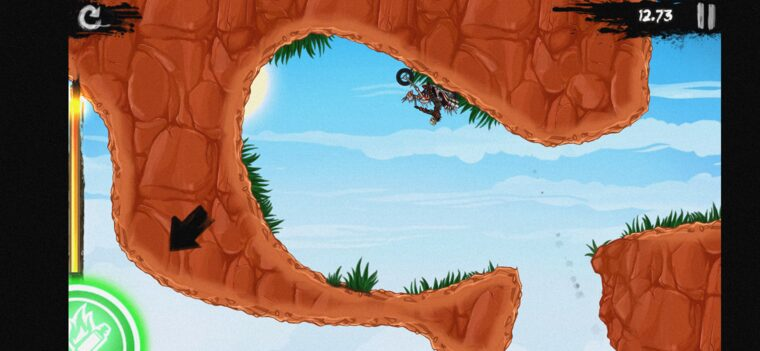
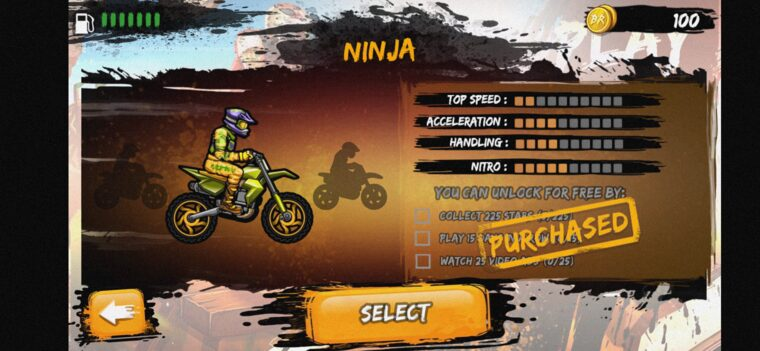
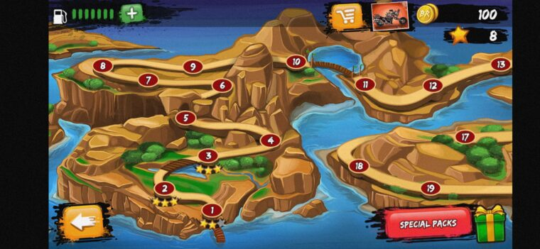
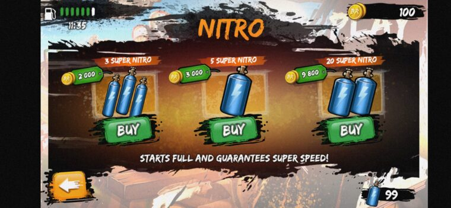

<div align="center">

# 🪦 → 🏍️ &nbsp; R E V E N A N T

### Reverse-engineering a *dead* 2014 mobile game back to life — and a one-click patcher that fixes it **in your browser**.

<p>
<a href="https://tyler-void.github.io/revenant/"></a>


</p>
<p>


</p>
<p>


</p>



<em>A 2014 trials game killed by a server shutdown — playable again, malware-free, controls restored, on a modern phone. Bring your own copy; the fixes run entirely in your browser.</em>

</div>

---

## TL;DR — what this project demonstrates

A dead, server-locked, malware-infested 2014 Android game — cocos2d-iphone shipped to Android via **Apportable/cocotron** (Objective-C over C++/Box2D, 32-bit ARM) — reverse-engineered and revived end-to-end. The headline deliverable is a **static, client-side web app that patches the user's own APK in RAM**: no server, no apktool, nothing uploaded. Under the hood:

- 🦀 **A DEX bytecode rewriter compiled to WebAssembly.** Rewrites a Dalvik method *in the browser* — appends a new `code_item`, repoints `code_off`, shifts every dependent file-offset, recomputes Adler-32 + SHA-1. **Byte-identical to a Python reference and accepted by baksmali (dexlib2).**
- 🔓 **A Blowfish save/level cipher, cracked without reimplementing it** — by driving the game's *own* native ARM cipher inside [**unidbg**](https://github.com/zhkl0228/unidbg) (a JVM/Unicorn emulator) as a decode **and** encode oracle. Round-trip device-verified.
- 🧩 **Binary `AndroidManifest.xml` (AXML) surgery + in-browser APK v1 signing** — strip tracking permissions/components and re-sign with WebCrypto + PKCS#7, no SDK. Output installs on Android 13.
- 🎮 **A native in-game mod menu** — an NDK `.so` injected at class-init, relocating ARM32 inline hooks, an ImGui overlay riding the GL `swapBuffers` hook, with touch.
- 🛠️ A reproducible CLI build, a level decode→edit→re-encode toolkit, and an honest write-up of the dead ends (including the one bug I *couldn't* crack).

**Brain & direction:** [Tyler](https://github.com/tyler-void). **Scalpel:** AI coding agents under direction. Built async, remote-first, on a 32-bit target where *every* off-the-shelf dynamic-analysis tool failed.

---

### 🩺 The patient

```
                                       Bike Rivals 1.5.2  (com.miniclip.bikerivals)
        ╔══════════════════╗          ──────────────────────────────────────────────
        ║   T O E   T A G  ║          Born      : 2014 · cocos2d-iphone → Android via
        ║                  ║                       Apportable / cocotron (ObjC/GNUstep)
        ║  com.miniclip    ║          Cause of  : online servers shut down → stuck in
        ║  .bikerivals     ║          "death"      World 1, nothing buyable, delisted
        ║                  ║          Tilt      : lean-to-flip DEAD on Android 12+
        ║  ☠  D.O.A.  ☠   ║                       (accelerometer never registers)
        ║                  ║          "Cures" on : every "MOD APK" online ships a
        ╚══════════════════╝          the street   remote-DEX MALWARE loader (dexapt.com)
                                       Prognosis : RESURRECTED ✓ — clean, offline, fixed
```

> A 2014 abandonware trials game I loved. The servers are gone, so a legit copy is a museum piece you can't really play; the "mods" online are malware. So I brought my own back from the dead — the defensible way: **methods and offsets only, never the game's bytes.**

---

## ✅ Restored & device-verified

| Was broken | Why | Fix |
|---|---|---|
| 🤸 **Tilt controls dead** (Android 12+) | The accelerometer never registers; the game also forwards to a native handler before it's bound | Re-register the sensor + a **DEX method rewrite** wrapping the native call in try/catch + a modern-landscape axis remap · [`docs/TILT-FIX.md`](docs/TILT-FIX.md) |
| 🌍 **Stuck in World 1** | World unlock is server-gated (stars + multiplayer wins) | Patch `isWorldUnlocked:` / `isUniverseUnlocked:` → **YES** |
| 🏍️ **Bikes un-buyable** | Ownership is server-confirmed; the store reads a native Obj-C getter | Patch the **real `unlocked` ivar getter** (found via emulation — see the war story) → **YES** |
| 🛢️ **Fuel runs out** | Tank drains, no server to refill | Redirect `gasBarsLeft` → `gasBarsTotal`: reads **full, always** (immune to every consume path) |
| 💨 **Nitro / ⛑️ helmets limited** | Consumables bought with dead coins | `consumableCount:` → **99**, `useConsumable:` never spends |
| 🕵️ **Tracking permissions** | A 2014 game asks for location, accounts, ads, push… | Strip them (location/accounts/billing/push) + the ad/UDID/GCM components — **aapt2-verified** |
| 🦠 **Every online "mod" is malware** | 3rd-party APK = remote-DEX loader phoning `dexapt.com` | Built from the **clean** original; malware never touched · [`docs/ANALYSIS.md`](docs/ANALYSIS.md) |

<div align="center">

&nbsp;

&nbsp;

</div>

---

## 🧪 The hard engineering (the interesting part)

### 1 · A DEX bytecode rewriter, in the browser (Rust → WASM)
The dead tilt controls can't be fixed with a same-size byte-patch — the fix changes a Dalvik method's body (re-register the sensor, wrap the native `onSensorChanged(FFFJ)` call in a `try/catch` for the bind-race, remap the axes for landscape). Doing that *without apktool, client-side* meant writing a real **DEX editor**:

- appends a new, larger `code_item` at the end of the code section and repoints the method's uleb `code_off`;
- **fixes up every `u32` file-offset ≥ the insertion point** (string-data, proto params, class-def, code-item debug, annotation sets/dirs, the map list) and bumps the map's `TYPE_CODE_ITEM` count;
- recomputes the DEX **Adler-32 + SHA-1** integrity fields.

Compiled to `wasm32-unknown-unknown` (raw C-ABI, no wasm-bindgen, ~34 KB) and **verified byte-identical to a Python oracle**, then round-tripped through **baksmali (dexlib2)** to prove the rewritten method disassembles correctly. → [`docs/patcher.md`](docs/patcher.md)

### 2 · The save/level cipher, cracked by emulating the game's own code
The encrypted `.dat` files are `"<len>\0"` + a **Blowfish** body (cocos2d/Apportable); levels are additionally gzip'd to a binary plist. Instead of reimplementing the cipher, I loaded `libgame.so` into **unidbg** and drove its *own* `cipher_init` / `setkey` / `process` routines via `objc_msgSend` — a faithful **decode *and* encode** oracle (a round-tripped, re-encrypted level loaded and played on a real device). Keys are captured on-device by an injected ARM logging stub and **never committed** — they're DMCA §1201 circumvention material. Frida crashes this 32-bit target; emulating a single `.so` in a JVM sidesteps the device entirely. → [`docs/research.md`](docs/research.md)

### 3 · The native unlock gate, via runtime layout recovery
The store's owned-check is Objective-C on the **GNUstep/cocotron** runtime with **non-fragile ivars** — accessor offsets are filled at *runtime*, so static getter patches read a phantom field (I patched the wrong ivar eight times). unidbg recovered the real `BikeInfo` layout and proved the gate reads `unlocked`@`0xb`. One byte: every bike. → [`docs/BIKE-UNLOCK-STATUS.md`](docs/BIKE-UNLOCK-STATUS.md)

### 4 · One-click patcher: AXML editing + in-browser signing + a shared manifest
The web app ([`web/`](web), React + Vite + TypeScript + Bun) patches the user's own APK in RAM with JSZip and:
- **binary-AXML editing** to splice out tracking `<uses-permission>` elements *and* whole ad/push/telemetry `<service>`/`<receiver>` subtrees (no apktool);
- **APK v1 (JAR) signing** with WebCrypto SHA-256 + node-forge PKCS#7 — the output **installs on Android 13**;
- in-place native ARM byte-patches driven from **one declarative `patches/manifest.json`** that *also* feeds the Python CLI build, so the two paths can't drift.

Auto-built and deployed to GitHub Pages by [a CI workflow](.github/workflows/deploy-pages.yml). **Live: [tyler-void.github.io/revenant](https://tyler-void.github.io/revenant/).**

### 5 · A native in-game mod menu (libmod)
An NDK lib injected via `GameActivity.<clinit>`, with a hand-rolled **relocating ARM32 inline hook** (overwrites a method's prologue, relocates the displaced PC-relative instructions into a trampoline, and aborts rather than corrupt on anything it can't relocate), an **ImGui overlay** drawn from the cocos2d `swapBuffers` hook, and touch routed into ImGui's event queue. Live gravity / camera-zoom / bike specs; a debug HUD; reset-progress. → [`docs/modmenu.md`](docs/modmenu.md)
> **Honest status:** on modified runs the in-race timer freezes — likely the game's ghost/leaderboard anti-tamper, but I couldn't isolate it deterministically after extensive bisecting, so it's documented as **open**. The mod menu is a free-play tool; the *distributed* build has no mod menu and a working timer.

---

## 📊 Status (no fluff)

| Component | State |
|---|---|
| Unlock + fuel/nitro + tilt fix + privacy cull | ✅ done · device-verified on Android 13 |
| **In-browser one-click patcher** (Rust→WASM + AXML + v1-sign) | ✅ done · **live on GitHub Pages** |
| Blowfish save/level cipher (decode **and** encode, via unidbg) | ✅ cracked · round-trip device-verified |
| Reproducible CLI build (`build/build.sh`) | ✅ done · deterministic, malware-free |
| Level editor (decode → JSON → web editor → re-encode → loadable) | 🚧 works · WYSIWYG render fidelity imperfect |
| Procedural level generator | 🟡 works · paused with the World-5 effort |
| In-game ImGui mod menu (`libmod`) | 🟡 works · run-timer freeze on modded runs **open/unresolved** |
| Offline achievements viewer | 🚧 in progress |

---

## ▶️ Use it

**Easiest — in your browser** (bring your own legally-owned `Bike+Rivals_1.5.2.apk`; nothing is uploaded):

> **[tyler-void.github.io/revenant](https://tyler-void.github.io/revenant/)** → drop your APK → pick fixes → download the patched, signed APK → `adb install`.

**Or the CLI** (reproducible, same patches from the shared manifest):

```bash
# deps: apktool, uber-apk-signer, python3, adb, keytool
mkdir -p base && cp /path/to/Bike+Rivals_1.5.2.apk base/
bash build/build.sh                       # decode → patch → rebuild → sign (auto debug keystore)
adb install -r dist/BikeRivals-1.5.2-*.apk
```

Re-installs preserve your save (stable signing key). The emulation harness is in [`tools/unidbg/`](tools/unidbg), the native mod in [`mod/`](mod), the web app in [`web/`](web), the Rust→WASM core in [`wasm/`](wasm).

---

## 🎓 Lessons from the operating table

- **A dead server doesn't kill copyright; it kills the fun.** Reviving a delisted game cleanly is a research problem, not piracy — done on the *patches-not-binaries* footing.
- **When every debugger fails, emulate the *library*, not the *device*.** Frida crashes the 32-bit game; SELinux blocks `/proc/mem`; the modern Android emulator dropped ARM. Running one `.so` in unidbg was the whole game.
- **GNUstep non-fragile ivars defeat naive static patching** — offsets are runtime-resolved (also why a hard-coded ivar offset is wrong; read the realized `_OBJC_IVAR_$_…` value at runtime).
- **Verify on real hardware, and don't trust noisy single runs.** My first "unlimited fuel" patched the wrong path and *looked* fine until the user played one level; a "speed" bug looked real for ~15 cycles and turned out to be a confound. Establish deterministic-vs-intermittent *before* bisecting.
- **Don't write a hypothesis up as fact.** The mod-menu timer freeze is real and unsolved — and it's documented that way, not papered over.

The full multi-day siege — every dead end, the overnight unidbg breakthrough, the timeline — is in **[`docs/JOURNEY.md`](docs/JOURNEY.md)**.

---

## ⚖️ Legal & preservation

This repo is the **defensible path**: it contains **only original work** — analysis, byte-offsets, patch scripts, and tooling — and **none of Miniclip's APK, assets, decompiled code, or cipher keys** (the [`.gitignore`](.gitignore) enforces it). You supply your own legally-owned copy; nothing here redistributes or lets you obtain the game. Fixing the broken motion controls is closest to a lawful user's error-correction right; the unlocks are research on a title whose rights-holder has walked away. **Distributing the patched APK is the bright line — don't.**

Sourced breakdown (incl. Vietnam's IP law and the §1201 anti-circumvention nuance) in [`docs/LEGAL.md`](docs/LEGAL.md); the community *patches-not-binaries* norm + DMCA mechanics in [`docs/PRESERVATION-PLAYBOOK.md`](docs/PRESERVATION-PLAYBOOK.md). **Not legal advice.**

---

## 📜 License

Independent, **non-commercial** work for **education, interoperability, and preservation research** — **not affiliated with or endorsed by Miniclip**. "Bike Rivals" and related marks/assets belong to their owners. This repo ships **no copyrighted game assets, binaries, or source** ([`.gitignore`](.gitignore) + [`CHECKSUMS`](CHECKSUMS) enforce it); a legally-obtained copy of the game is required to build, and **this repo cannot be used to obtain or play it.**

- **Code** (`build/`, `tools/`, `mod/`, `web/`, `wasm/`) → **GNU GPL v3.0** ([`LICENSE`](LICENSE))
- **Docs** (`docs/`, `README`) → **CC BY-SA 4.0** · see [`NOTICE`](NOTICE) for exact scope.

<div align="center">
<sub>Reverse engineering & direction: <a href="https://github.com/tyler-void">Tyler</a> · execution by AI coding agents under direction · engine archaeology: Miniclip (2014), Apportable, cocotron, GNUstep · crowbar of last resort: <a href="https://github.com/zhkl0228/unidbg">unidbg</a>.</sub>
<br><sub>From toe-tag to throttle. Built async, remote-first, and slightly over-engineered on purpose.</sub>
</div>
